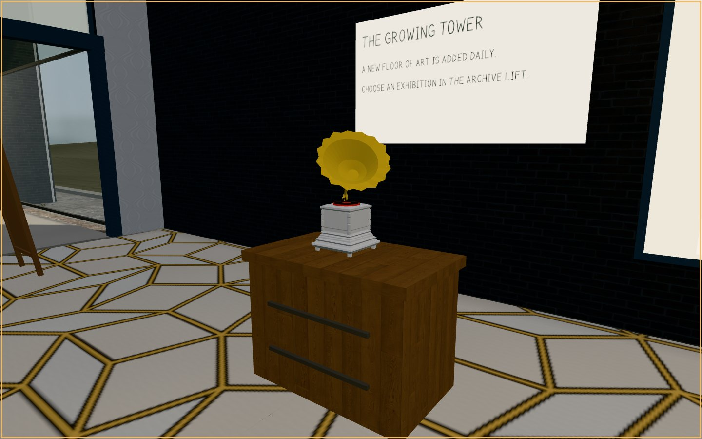

# PROPORTION PIECE

*How far can the golden ratio govern a composition while its marks remain visibly human?*

**An ongoing generative artwork in drawing, sculpture, architecture and time.**

[Enter the drawing machine](https://southernadd-cmyk.github.io/algoart/) · [Walk the exhibition](https://southernadd-cmyk.github.io/algoart/gallery/visit/) · [View the daily archive](https://southernadd-cmyk.github.io/algoart/gallery/) · [About the project](https://southernadd-cmyk.github.io/algoart/about/)

## An invitation, not a proof

I use the golden ratio, φ (approximately 1.618), not as a guarantee of beauty but as a constraint to test. It has an unusually persistent reputation: a number said to explain the proportions of everything from a painting to a shell. Some of those connections can be demonstrated. Others are stories we have chosen to tell about beauty.

PROPORTION PIECE asks what happens when that number is given real authority over a composition — and what happens when the work refuses to be explained by it. Its influence can be seen in divisions, intervals, directions, scale and the space left empty. But it does not settle the harder questions: *When does a drawing become interesting? Where does control end? How much of what we see is the rule, and how much is our own judgement?*

The project began as **ALGO/ART** and continues under a new name. It is not a collection of images arranged around an idea after the fact. The rule is present in the making, and the experiment continues in the act of looking.

## The mark resists the rule

Eight composition systems establish different kinds of order: orbital arrangements, golden trajectories, recursive divisions, radiating fields, networks, growth, constructed shapes and automatic marks.

Five simulated drawing materials give those structures different bodies: **Marker, Tissue & Graphite, Watercolour, Oil Paint, and Action Painting**. A line can wobble or run dry; pigment can gather at an edge; a painted gesture can look uncontrolled even when its underlying position was precisely chosen. These are procedures written in JavaScript, not photographs of physical brushstrokes and not AI-generated images.

That distinction is central to the work. The machine cannot literally possess a hand, yet the marks can retain qualities we associate with one. It is the distance between calculated arrangement and imperfect appearance that interests me. A stronger application of φ does not always make a stronger drawing.

| A rule in lines | A rule in gesture |
| :--- | :--- |
|  |  |
| *Recursive Divisions · Marker* | *Growth Systems · Action Painting* |

*Both drawings belong to the [18 October 2026 edition](https://southernadd-cmyk.github.io/algoart/gallery/2026-10-18/). The other materials can be explored in the daily archive.*

## The exhibition is part of the piece

The [virtual exhibition](https://southernadd-cmyk.github.io/algoart/gallery/visit/) is not merely a place to display the output. **The gallery itself is generated around the archive it holds.** Each dated collection becomes another floor in a growing Three.js tower. The accumulating record of making becomes an architectural form: time made walkable.

Room shapes are cut using golden-section relationships, then reconciled with the ordinary demands of a building — doors, circulation, clearances, sightlines and places to stand. The hanging of a picture, the spacing of light, the bronze Penrose details and the relation between an artwork and the wall around it all put proportion under pressure. The building is deliberately quiet: warm plaster, dark metal, restrained bronze and simplified figures, so the colour belongs primarily to the work.

Some portrait drawings become sculptures, their source geometry reinterpreted as layered volumes, ribbons or strata rather than simply printed onto an object. The square outside, the reception, the lift and the rooms are part of the experience; not every piece of furniture or surface is claimed to arise from φ.


*The growing exhibition tower. Fresh screenshot from the current Three.js gallery, captured 1 November 2026.*

In reception, a **Translation Area** extends drawings into moving images using TouchDesigner, while a **gramophone** compares moments in the written score with moments in recorded time. Mozart and Debussy offer different ways of hearing — or failing to hear — a proposed proportion. Nothing is inserted into the recordings to make the mathematics audible. The listener decides what matters.

The other visitors are not just scale figures. They can be spoken to. Their rule-based conversations are grounded in works on the floor, their own observations and disagreements, and a wider body of knowledge about art, proportion and its myths. The **More topics…** chip makes that knowledge discoverable. Their voices are part of the exhibition, but they are not generative language models.

| Reception | A listening experiment |
| :--- | :--- |
|  |  |
| *An entrance to the accumulating archive.* | *The gramophone asks where proportion falls in music.* |

*Both are documentary screenshots captured from the live exhibition code on 1 November 2026, not illustrative reconstructions.*

## The visitor can change the work

The [browser editor](https://southernadd-cmyk.github.io/algoart/) is open and free to use. A seed makes a composition reproducible, but a drawing is not a closed result. Choose another material; change the geometry; pull the influence of φ back; alter the colour of the paper. **Another** makes a new drawing, **Mutate** moves away from the present one, and **Four at once** puts alternatives beside each other. **Show the φ** reveals some of the system beneath the surface.

The canvas is intentionally a practical **7:5 format**, not a golden rectangle. The proportion works *inside* the image. The editor can export PNG, SVG and pen-plotter paths, and preserve a particular drawing through its seed, settings and renderer version. A viewer's experiments are their own; they are not automatically added to the curated daily archive.

The [daily gallery](https://southernadd-cmyk.github.io/algoart/gallery/) continues to accumulate landscape and portrait works. The date of a drawing determines its place in the tower, but not its meaning. New floors do not resolve the question posed by the earliest ones. They keep asking it.

## An unfinished question

A computer can apply a ratio with perfect consistency. It cannot, by doing so, guarantee that anything worth looking at will appear.

I want PROPORTION PIECE to occupy that gap: between a mathematical system and an aesthetic decision, between the repeated procedure and the individual mark, between the work an algorithm makes and the work a person sees. **The number proposes. The drawing answers — sometimes by disagreeing.**

---

<details>
<summary><strong>For readers who want to look inside the machinery</strong></summary>

### How the images are made

The drawings use deterministic, seeded JavaScript with **eight composition engines** and **five simulated materials**. Geometry renderer **V9** permits independent paper-colour selection without changing its seeded composition or pigment palette; materials have their own revision histories. Older artwork links retain the renderer and settings that produced them. The [renderer and material history](MATERIAL_HISTORY.md) documents compatibility.

| Composition series | Material |
| --- | --- |
| Orbital Studies · Golden Trajectories · Recursive Divisions · Radiant Systems · Connected Fields · Growth Systems · Constructed Forms · Automatic Marks | Marker · Tissue & Graphite · Watercolour · Oil Paint · Action Painting |

The [calibration audit](CALIBRATION_AUDIT.md) distinguishes exact mathematical relationships from artist-tuned choices. [Tuning notes](TUNING.md) discuss output stability. The [development log](DEVELOPMENT_LOG.md) records experiments, revisions, and dead ends, including the earlier ALGO/ART name.

### Files and reproduction

The [editor](https://southernadd-cmyk.github.io/algoart/) is a static web application. The exhibition is a bundled Three.js environment with prebuilt geometry, staged floor loading and room-visibility culling. The `gallery/visit/` and `test/virtual-gallery/` directories are separate live and experimental towers.

To run the site locally:

```sh
git clone https://github.com/southernadd-cmyk/algoart.git
cd algoart
python3 -m http.server 8000
```

Visit `http://localhost:8000/`. On Windows, `py -m http.server 8000` is an alternative. Node.js and npm are used for automated checks and gallery bundling:

```sh
npm ci
npm run test:renderer-lock
npm run test:orientation
npm run test:plotter
npm run gallery:bundle:phi
```

The gallery source must be bundled before changes to it appear in the deployed gallery. PNG exports preserve visible paint texture; SVG and plotter SVG preserve underlying vector paths rather than the full raster material. Physical plotter pen-change behaviour has not been verified on hardware.

For publishing details, see [automation documentation](automation/README.md). The archive itself is accessible from the [daily gallery](https://southernadd-cmyk.github.io/algoart/gallery/).

</details>
