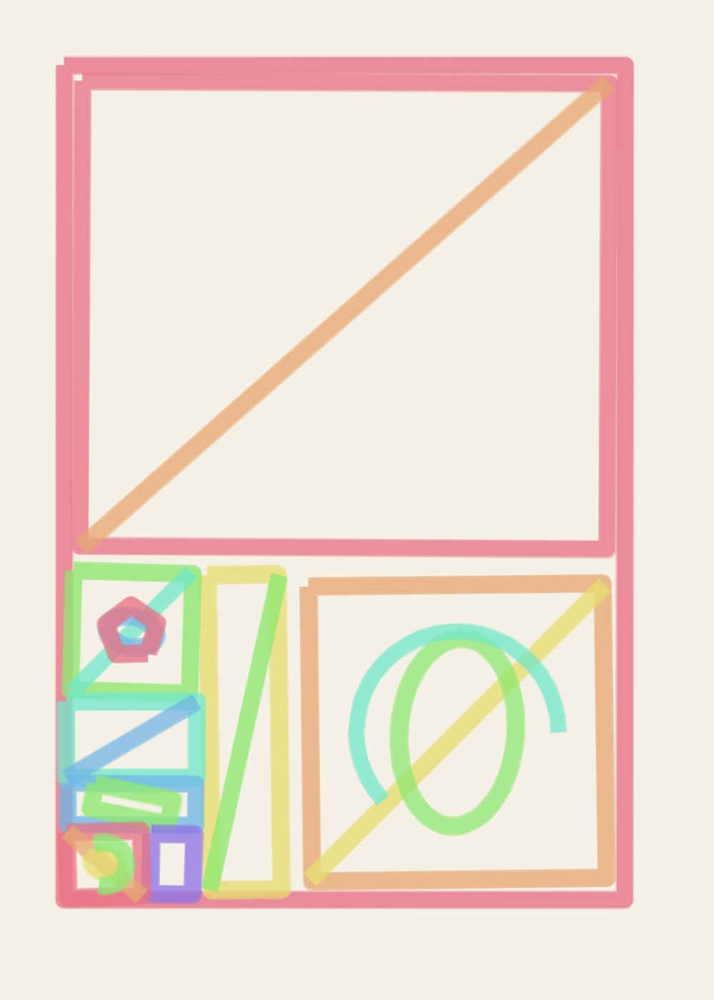
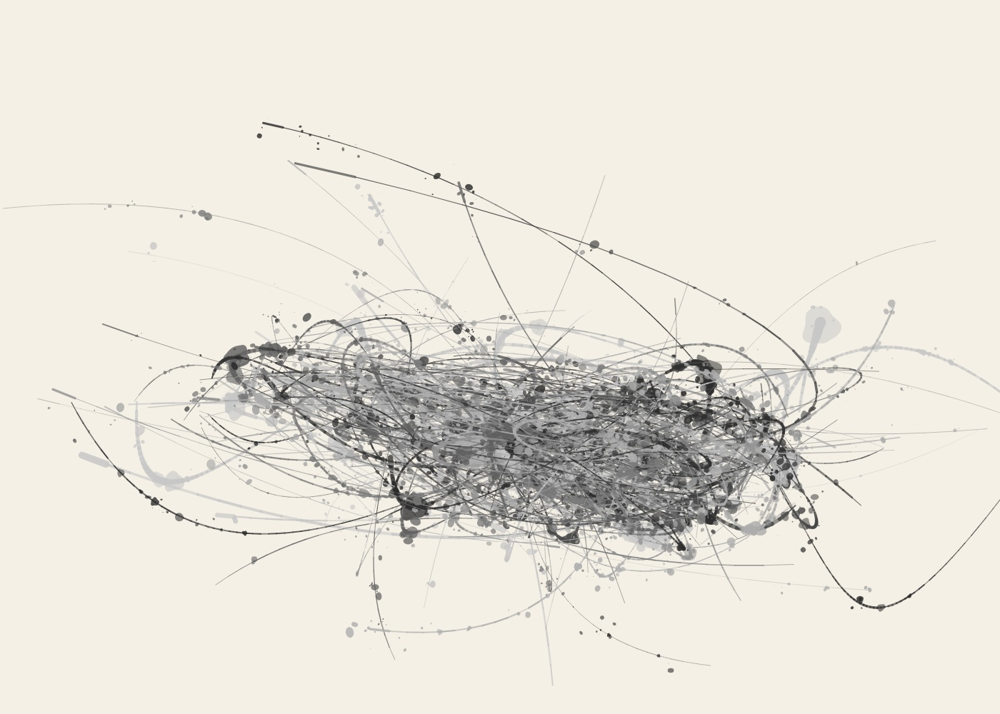
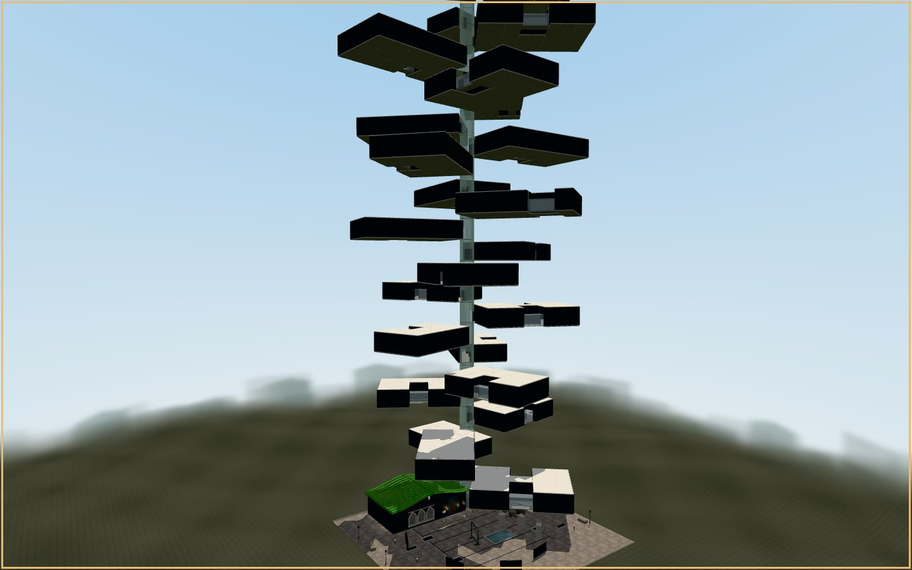
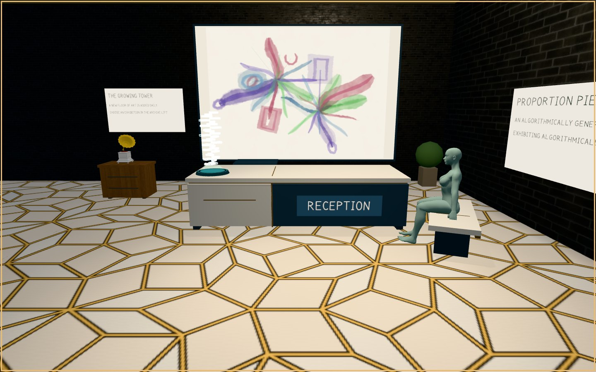

# PROPORTION PIECE

*How far can the golden ratio govern a composition while its marks retain the irregularity of hand-drawing?*

**An ongoing generative artwork by Adam Clement, made in code and unfolding through drawing, sculpture, architecture and time.**

[Enter the drawing machine](https://southernadd-cmyk.github.io/algoart/) · [Explore Confluence](https://southernadd-cmyk.github.io/algoart/confluence/) · [Walk the exhibition](https://southernadd-cmyk.github.io/algoart/gallery/visit/) · [View the daily archive](https://southernadd-cmyk.github.io/algoart/gallery/) · [About the project](https://southernadd-cmyk.github.io/algoart/about/)

## Artist statement

I use code to test what happens when a mathematical rule meets the irregular character of a hand-drawn mark. In PROPORTION PIECE, the golden ratio proposes a structure, while simulated materials give the marks texture, variation and the appearance of gesture. The images are generated, not drawn by hand. Neither the number nor the machine can decide whether a drawing works. That judgement remains with the person looking.

## The premise

I use the golden ratio, φ (approximately 1.618), not as a guarantee of beauty but as a constraint to test. It has an unusually persistent reputation: a number said to explain the proportions of everything from a painting to a shell. Some of those connections can be demonstrated. Others are stories we have chosen to tell about beauty.

PROPORTION PIECE asks what happens when that number is given real authority over a composition — and what happens when the work refuses to be explained by it. Its influence can be seen in divisions, intervals, directions, scale and the space left empty. But it does not settle the harder questions: *When does a drawing become interesting? Where does control end? How much of what we see is the rule, and how much is our own judgement?*

The project began as **ALGO/ART** and continues under a new name. It is not a collection of images arranged around an idea after the fact. The rule is present in the making, and the experiment continues in the act of looking.

## The mark resists the rule

Eight composition systems establish different kinds of order: orbital arrangements, golden trajectories, recursive divisions, radiating fields, networks, growth, constructed shapes and automatic marks.

Five simulated drawing materials give those structures different bodies: **Marker, Tissue & Graphite, Watercolour, Oil Paint, and Action Painting**. A line can wobble or run dry; pigment can gather at an edge; a painted gesture can look uncontrolled even when its underlying position was precisely chosen. These are procedures written in JavaScript, not photographs of physical brushstrokes and not AI-generated images.

That distinction is central to the work. The machine cannot literally possess a hand, yet the marks can retain qualities we associate with one. It is the distance between calculated arrangement and imperfect appearance that interests me. A stronger application of φ does not always make a stronger drawing.

| A rule in lines | A rule in gesture |
| :--- | :--- |
|  |  |
| *Recursive Divisions · Marker* | *Growth Systems · Action Painting* |

*Both drawings belong to the [18 October 2026 edition](https://southernadd-cmyk.github.io/algoart/gallery/2026-10-18/). The other materials can be explored in the daily archive.*

## Confluence — three procedural artists, one sheet

[Confluence](https://southernadd-cmyk.github.io/algoart/confluence/) is a second drawing studio inside PROPORTION PIECE. Three independent procedural artists, each assigned one composition system and one material, work on the same paper. They are **software drawing procedures**, not other visitors or live collaborators. Each artist's marks are recorded and then spatially adapted in response to what the other hands have drawn.

The visitor can change the **Collaboration φ pull** to distribute turns by golden-ratio proportions or equally, use **Rotate lead** to assign the largest share to another artist, and compare the same seed and starting settings under both schedules. Turn counts govern drawing order and opportunities for response rather than how visually prominent an opaque or translucent material becomes. All three artists' source gestures are used.

The solo editor's **Explore in Confluence** link transfers its seed and drawing controls as the starting settings for Artist 1. It does not open a multiplayer room or preserve a pixel-identical solo artwork: the new shared drawing is a different interpretation. Confluence images are not automatically added to the daily gallery.

## The exhibition is part of the piece

The [virtual exhibition](https://southernadd-cmyk.github.io/algoart/gallery/visit/) is not merely a place to display the output. **The gallery itself is generated around the archive it holds.** Each dated collection becomes another floor in a growing Three.js tower. The accumulating record of making becomes an architectural form: time made walkable.

Room shapes are cut using golden-section relationships, then reconciled with the ordinary demands of a building — doors, circulation, clearances, sightlines and places to stand. The hanging of a picture, the spacing of light, the bronze Penrose details and the relation between an artwork and the wall around it all put proportion under pressure. The building is deliberately quiet: warm plaster, dark metal, restrained bronze and simplified figures, so the colour belongs primarily to the work.

Some portrait drawings become sculptures, their source geometry reinterpreted as layered volumes, ribbons or strata rather than simply printed onto an object. The square outside, the reception, the lift and the rooms are part of the experience; not every piece of furniture or surface is claimed to arise from φ.



*The growing exhibition tower, documented in the Three.js gallery on 1 November 2026.*

In reception, a **Translation Area** extends drawings into moving images using TouchDesigner. Visitors can also opt into quiet background music using the gallery toolbar. The recordings are not offered as evidence for the golden ratio.

The other visitors are not just scale figures. They can be spoken to. Their rule-based conversations are grounded in works on the floor, their own observations and disagreements, and a wider body of knowledge about art, proportion and its myths. The **More topics…** chip makes that knowledge discoverable. Their voices are part of the exhibition, but they are not generative language models.



*An entrance to the accumulating archive, photographed in the live exhibition on 1 November 2026. The gallery has evolved since this photograph was taken.*

## The public drawing machine

The [browser editor](https://southernadd-cmyk.github.io/algoart/) is open and free to use. A seed makes a composition reproducible, but a drawing is not a closed result. Choose another material; change the geometry; pull the influence of φ back; alter the colour of the paper. **Another** makes a new drawing, **Mutate** moves away from the present one, and **φ Four (Phi Four)** compares four versions of the *current* drawing at Additional φ pull values of **0%, 38.2%, 61.8% and 100%**. The seed, composition engine, material, orientation, paper and every other setting stay fixed; select any preview to apply its φ pull. Even at 0%, the underlying composition still uses φ — this control changes its additional influence, not whether the ratio exists in the work. **Show the φ** reveals some of the system beneath the surface.

The canvas is intentionally a practical **7:5 format**, not a golden rectangle. The proportion works *inside* the image. The editor can export PNG, SVG and pen-plotter paths, and preserve a particular drawing through its seed, settings and renderer version. The public editor and the published daily archive are separate: visitors can make and save their own drawings, but these are **not** automatically added to the daily editions or the exhibition tower.

The [daily gallery](https://southernadd-cmyk.github.io/algoart/gallery/) continues to accumulate landscape and portrait works. The date of a drawing determines its place in the tower, but not its meaning. New floors do not resolve the question posed by the earliest ones. They keep asking it.

## An unfinished question

The proportions can be exact; the marks need not look that way. New works and floors do not prove that φ makes a drawing beautiful. They keep exposing the distance between a rule and an aesthetic decision. **The number proposes. The drawing answers — sometimes by disagreeing.**

---

<details>
<summary><strong>For readers who want to look inside the machinery</strong></summary>

### How the images are made

The drawings use deterministic, seeded JavaScript with **eight composition engines** and **five simulated materials**. Geometry renderer **V10** improves palette coverage: the Colours slider offers up to **14 inks**; all ten chromatic palettes now produce **14 separate hue angles** at the maximum (at least 6° apart), not just lighter/darker repetitions. Monochrome instead offers 14 neutral grey values. Source marks intentionally distribute the chosen inks before the material interprets them. The selected material interprets those marks as ink, tissue, watercolour or paint; visible pixel colours still mix and overlap naturally. V9 introduced independent paper-colour selection. Saved V1–V9 links retain their original renderer and materials have separate revision histories. Older artwork links retain the renderer and settings that produced them. The [renderer and material history](MATERIAL_HISTORY.md) documents compatibility.

| Composition series | Material |
| --- | --- |
| Orbital Studies · Golden Trajectories · Recursive Divisions · Radiant Systems · Connected Fields · Growth Systems · Constructed Forms · Automatic Marks | Marker · Tissue & Graphite · Watercolour · Oil Paint · Action Painting |

The [calibration audit](CALIBRATION_AUDIT.md) distinguishes exact mathematical relationships from artist-tuned choices. [Tuning notes](TUNING.md) discuss output stability. The [development log](DEVELOPMENT_LOG.md) records experiments, revisions, and dead ends, including the earlier ALGO/ART name.

### Files and reproduction

The [editor](https://southernadd-cmyk.github.io/algoart/) is a static web application. The public exhibition at `gallery/visit/` is a bundled Three.js environment with prebuilt geometry, staged floor loading and room-visibility culling. `test/virtual-gallery/` is a separate experimental entry point and bundle for testing changes; it is not the public exhibition.

To run the site locally:

```sh
git clone https://github.com/southernadd-cmyk/algoart.git
cd algoart
python3 -m http.server 8000
```

Visit `http://localhost:8000/`. On Windows, `py -m http.server 8000` is an alternative. Node.js and npm are used for automated checks and gallery bundling:

```sh
npm ci
npm run test:renderer-lock
npm run test:orientation
npm run test:plotter
npm run gallery:bundle:phi
```

The gallery source must be bundled before changes to it appear in the deployed gallery. PNG exports preserve visible paint texture; SVG and plotter SVG preserve underlying vector paths rather than the full raster material. Physical plotter pen-change behaviour has not been verified on hardware.

For publishing details, see [automation documentation](automation/README.md). The archive itself is accessible from the [daily gallery](https://southernadd-cmyk.github.io/algoart/gallery/).

</details>
